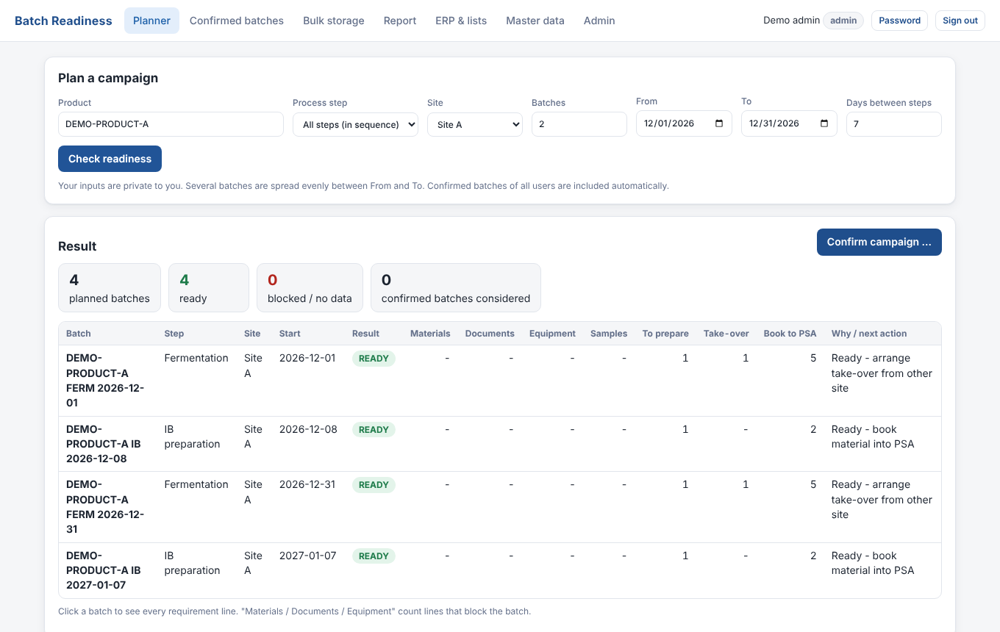
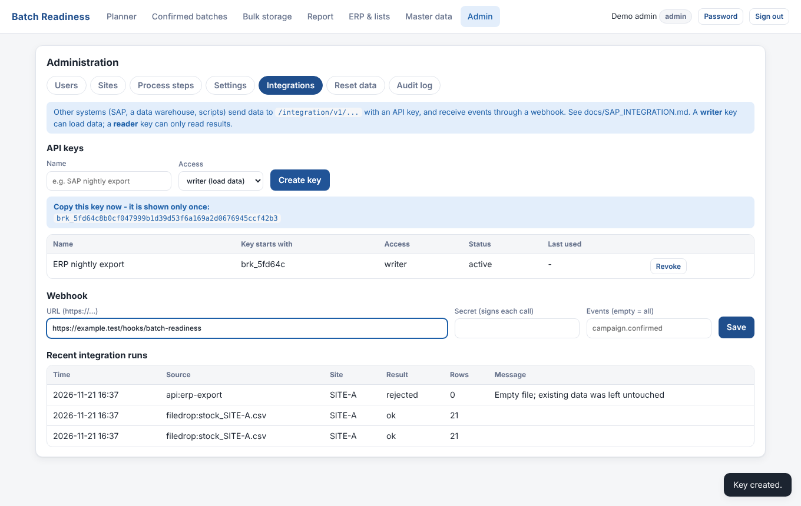

# Batch Readiness

**Decision support for production planners: before a campaign starts, does every batch have what it needs - and if not, what exactly is missing and what should be done next?**

Version 2 is a self-hosted **web service**: Node.js backend, SQLite database, browser UI, a documented **REST API** and
**ERP / SAP integration** (file drop, REST push, OData pull, signed webhooks). The business logic is the same
tested engine that ran in version 1 (a Google Apps Script app); only the platform underneath changed.

Built for biopharmaceutical manufacturing (fermentation, downstream), but the logic fits any multi-step process with
bills of materials, in-house intermediates, qualified equipment and controlled documents.




*Screenshots use invented demo data.*

## The problem

Planning several batches in parallel means checking, per batch and in order: stock of every material (after earlier batches took their share),
whether that stock is usable (accepted category, usable storage type, not expired at batch start), whether a missing in-house stock solution can be prepared
from its components, whether equipment is qualified, calibrated and free, whether documents are effective on the start date, whether the previous step's
output arrives in time, and whether another site could cover a shortage. Done by hand this is spreadsheets, ERP look-ups and surprises on the day.

## The solution

Describe each product once (requirements per process step, recipes), feed in ERP stock and lists, plan a campaign. Every batch returns
**READY / BLOCKED**, the reason per line and a **next action** (order, prepare a solution, take over from another site, clarify equipment).

| | |
|---|---|
| Allocation | Confirmed batches reserve first, planned batches follow in date order; in-house preparations rounded up to whole preparations, components checked recursively |
| Multi-site | Take-over recommendations when another site has the material |
| Users | Roles viewer / planner / editor / admin, salted scrypt hashes, sessions, lock-out after failed sign-ins, audit log |
| Workflow | Confirm campaigns, complete batches, bulk storage, planned-vs-produced report |
| Data-driven | The repository contains **no data**. Sites, steps, products, requirements, recipes and every ERP export come from the customer |

## What version 2 adds

| Version 1 (Apps Script) | Version 2 |
|---|---|
| Runs only inside Google; script quotas, 100 KB cache items, `google.script.run` latency | Any host: Docker, VM, on-premises. No platform quotas |
| Google Sheet as database | SQLite with transactions, indexes, online backups |
| Browser-only data entry | REST API with API keys; SAP-ready connectors |
| No outbound events | Signed webhooks (`campaign.confirmed`, `batch.*`) |
| Manual backup | Nightly automatic backups, pruning of logs, health endpoints |

```
Browser (HTML/JS)  --/api/v1/rpc-->  Express  -->  core/ (engine, auth, roles, audit)  -->  SQLite
ERP / SAP  --/integration/v1/*--------^   |                  one transaction per write action
SAP OData (pull) / folder drop ----> connectors             events --> signed webhooks
```

`core/` is plain JavaScript with no platform dependencies; the server provides storage, hashing and time through a small port (`server/runtime.js`).

## Quick start

```bash
npm ci
npm start                      # http://localhost:8080 ; the log prints a one-time setup code
```
Open the page, **register the first administrator with the setup code** (or set `ADMIN_EMAIL` / `ADMIN_PASSWORD` before the first start).
Then add sites and steps (Admin), import ERP stock and lists (Master data), and plan.

Docker: `docker compose up -d --build`. Details: [docs/DEPLOYMENT.md](docs/DEPLOYMENT.md).

Optional public demo copy with **invented** data and a read-only visitor: `npm run seed-demo`.

## Integration

* **REST** - `PUT /integration/v1/stock|documents|equipment|bio`, `PUT /integration/v1/master/{table}`, `GET /integration/v1/readiness`. API keys are created in *Admin > Integrations* and shown once.
* **SAP field names** (MATNR, CHARG, LGORT, MENGE, VFDAT, WERKS ...) and SAP number/date formats are recognised; unusable rows are reported, never guessed.
* **Safety guards** - an empty or mostly unusable extract is rejected and existing data stays; `dryRun=true` previews; each import is one transaction.
* **Connectors** - SAP OData V2 pull (stock per plant), CSV folder drop, scheduled by `config/integrations.json`.
* **Webhooks** - HMAC-SHA256 signed, retried with back-off.

Full guide: [docs/SAP_INTEGRATION.md](docs/SAP_INTEGRATION.md). Machine-readable: [docs/openapi.yaml](docs/openapi.yaml).

> **Honest status:** the SAP connectors are tested against mock OData servers and sample files, **not against a live SAP system**.
> Field names, authorizations and service availability differ between SAP releases; plan a short validation with your SAP team (see the guide).

## Tests

```
npm test          # 20 engine scenarios, number/date/CSV mapping, REST API, connectors (mock SAP, folder drop, webhook)
npm run test:ui   # browser test (needs Playwright)
```
A 20,000-row stock import takes about 0.1 s and a four-batch calculation about 0.1 s on a small VM (measured on the development container, not a guarantee).

## Documentation

[ARCHITECTURE](docs/ARCHITECTURE.md) - [DEPLOYMENT](docs/DEPLOYMENT.md) - [SAP_INTEGRATION](docs/SAP_INTEGRATION.md) - [openapi.yaml](docs/openapi.yaml)

## Not a validated system

This tool supports decisions; it is not validated GMP software out of the box. Computerised-system validation (CSV) of a deployment is the operator's responsibility.

License: MIT
